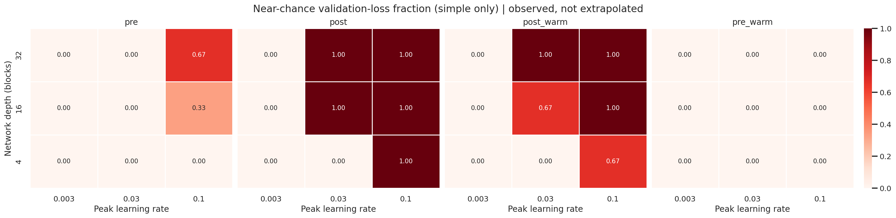
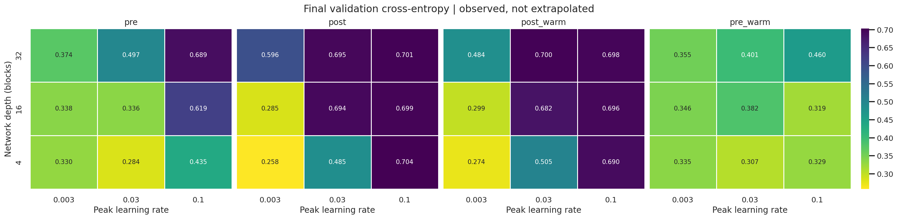
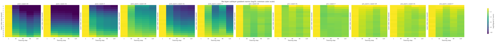
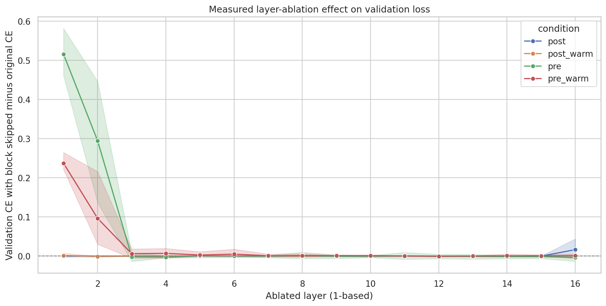

# Empirical CPU stability sweep — 2026-10-22

## Verified scope

**108 completed CPU runs**: `3 depths × 3 peak learning rates × 4 conditions × 3 matched seeds`; plus **192 inference-time block ablations** (`16 layers × 4 arms × 3 seeds`) from a separately trained checkpoint set. This is NOT a GPU run, a real-text language-model benchmark, or a general claim about all Transformers.

- Task: fixed deterministic nonlinear Gaussian **binary classification** (8,192 train / 1,024 validation samples).
- Model: residual MLP, width 32, depth 4/16/32, FFN width 64, final LayerNorm shared.
- Four arms: `pre`, `post`, `post_warm`, `pre_warm`; same initialization and batch sequence per matched seed.
- Seeds: 7, 19, 31. AdamW, batch 64, FP32, no gradient clipping, 120 optimizer steps.
- Peak LR: 0.003 / 0.03 / 0.1; warmup: 24 optimizer steps (warmup arms only).
- Numerically divergent: any non-finite training loss, gradient norm or evaluated validation loss.
- Near-chance: final validation CE >= `ln(2) - 0.02` (binary-classification-specific diagnostic, not divergence).
- Nonlearning: baseline-minus-final validation CE < 0.02 (different from near-chance).
- Loss spikes: instantaneous training loss > `max(2.0, 3 × median of preceding 20 losses)` after 10 preceding losses. Not a universal spike definition.

## Measured outcomes

Every one of the 108 runs completed without detected NaN/Inf. **The numerical-failure heatmap is all zeros**; that is not evidence that every run learned. The near-chance map is much more informative for this short training budget.

At `depth=32`, per-condition **mean final validation CE** across three seeds:

| Peak LR | Pre-LN | Post-LN | Post-LN + warmup | Pre-LN + warmup |
|---|---:|---:|---:|---:|
| 0.003 | 0.374 | 0.596 | 0.484 | 0.355 |
| 0.030 | 0.497 | 0.695 | 0.700 | 0.401 |
| 0.100 | 0.689 | 0.701 | 0.698 | 0.460 |

In this **MLP setup only**:

- At low LR (0.003), Post-LN at depths 4 and 16 had lower mean validation CE than Pre-LN. Norm placement alone therefore does not determine the winner.
- At LR 0.03/0.1 for depth 32, all three Post-LN seeds and all three Post-LN+warmup seeds finished near binary-classification chance CE.
- Pre-LN+warmup avoided the near-chance threshold for every measured depth/LR/seed combination, although its final loss still varied substantially.
- A fixed 24-step warmup **did not rescue** Post-LN at the high LR; trying additional warmup lengths and cumulative-LR-matched schedules is necessary before drawing a general conclusion about warmup.

### Depth 16, LR 0.03 — final sampled per-layer diagnostics

Three-seed means (FFN parameter gradient norm at the recorded final step):

| Quantity | Pre | Post | Post + warmup |
|---|---:|---:|---:|
| First-layer FFN gradient L2 | 0.225 | ~1.6e-11 | ~2.3e-7 |
| Last-layer FFN gradient L2 | 0.006 | 0.004 | 0.015 |
| Final-layer output RMS | 112.29 | 1.97 | 1.67 |

This is consistent with Post-LN showing very weak early-layer parameter gradients in this configuration, while Pre-LN allows strong residual-stream activation accumulation. However, these norms **do not directly measure full-network Jacobian singular values**, and large activations do not imply numerical divergence by themselves.

### Functional layer ablation

Separately trained `depth=16`, `LR=0.03`, three-seed checkpoints were evaluated after replacing each block with a skip connection (one block at a time) on a **fixed first 256 examples of the validation set**. Reported outcome: `validation_CE(skip one block) - original_CE`.

Mean CE increase when skipping **layer 1**: Pre-LN ≈ **+0.516**, Pre-LN + warmup ≈ **+0.237**; Post-LN ≈ **0.000**, Post-LN + warmup ≈ **+0.002**. Skipping a Post-LN block also removes its normalization, so the comparison measures **whole-block functional dependence**, not pure attention/FFN feature contribution. Layer 1 is not a proxy for all 16 layers; consult the full profile.

## Figures (observed, shared normalization / scales)









Raw data: [per-seed runs](../results/cpu_2026_10_22/stability_runs.csv), [grouped summaries](../results/cpu_2026_10_22/stability_summary.csv), [block ablations](../results/cpu_2026_10_22/layer_ablation.csv). [Interactive Plotly matrix](../results/cpu_2026_10_22/matrix_interactive.html) (download and open locally for interactivity).

## Reproduce

```bash
pip install -e '.[dev]'
python -m pytest -q
python scripts/run_matrix.py \
  --stage simple --depths 4 16 32 --lrs .003 .03 .1 \
  --seeds 7 19 31 --steps 120 --warmup 24 --width 32 \
  --heads 4 --batch 64 --log-every 30 --out runs/repro_scan

# Separate checkpoints for ablation:
python -m normlab.cli \
  --stage simple --layers 16 --width 32 --heads 4 --steps 120 \
  --warmup 24 --batch 64 --lr .03 --seeds 7 19 31 \
  --save-checkpoints --out runs/ablation_fit
python scripts/layer_ablation.py --run runs/ablation_fit --val-limit 256
```

For a **genuine GPU / real-text** experiment, configure your own GitHub Actions GPU-labeled self-hosted runner and manually dispatch `.github/workflows/real_text_gpu.yml`, or run `bash scripts/run_real_text_gpu.sh` on a machine with CUDA and network access. The workflow does not imply that any GPU experiment has already executed.

## Limitations and next claims not yet established

The experiment uses a shallow-to-deep residual **MLP**, a tiny training budget (120 updates), and three seeds. It establishes neither causal attribution of individual gradient effects nor the behavior of a fully trained LLM on WikiText-2/TinyStories. The warmup and no-warmup arms have different cumulative LR; a further control with matched cumulative LR is required. The individual observations should not be interpreted as universal statistical laws.
